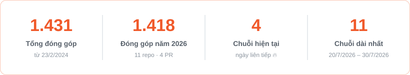

# Tạ Anh Tài

**Full-stack Developer · Mèo Software**

*Xây dựng phần mềm gọn nhẹ, dễ dùng — giải quyết đúng bài toán thực tế.*

Web app · AI cho tiếng Việt · Thị giác máy tính &nbsp;|&nbsp; Đắk Lắk, Việt Nam

---

## Giới thiệu

Tôi phát triển phần mềm trọn gói cho đơn vị, cửa hàng và cộng đồng địa phương — từ phân tích nghiệp vụ, thiết kế, lập trình đến triển khai và vận hành.

- **Web app & PWA** — backend, giao diện, triển khai VPS với CI/CD, sao lưu và bảo mật; dùng tốt trên cả điện thoại.
- **AI cho tiếng Việt** — nhận diện cảm xúc, nhận dạng giọng nói, trợ lý AI chạy cục bộ (Ollama).
- **Thị giác máy tính** — theo dõi phương tiện, phát hiện tai nạn, nhận dạng biển số.

## Công nghệ

| Lĩnh vực | Công cụ |
| --- | --- |
| Ngôn ngữ | JavaScript, TypeScript, Python, C# |
| Frontend | React, Vite, Leaflet, PWA |
| Backend & CSDL | Node.js, Express, Prisma, SQLite, SQL Server, .NET / WPF |
| AI & thị giác máy tính | YOLOv8, Whisper, Ollama, Gemini |
| Hạ tầng | Linux VPS, GitHub Actions |

## Dự án tiêu biểu

### Sản phẩm

| Dự án | Mô tả | Công nghệ |
| --- | --- | --- |
| **Sổ nhiệm vụ** riêng tư | Giao và theo dõi nhiệm vụ cho phòng, các đội: tiến độ, phê duyệt, báo cáo, nhập/xuất Excel, PDF, phân quyền. | Node.js · SQLite · React |
| **Sinh Kế Xanh** riêng tư | Sổ bán hàng một chạm và chợ nông sản cho hội viên Hội Phụ nữ cơ sở; bán được khi mất mạng, nhắc nợ qua Zalo. | TypeScript · PWA · Zalo Mini App |
| **RentHub** riêng tư | Sàn cho thuê phòng trọ, nhà, đất: đặt lịch xem, hợp đồng, hoá đơn điện nước, thanh toán QR, song ngữ. | React · Express · Prisma |
| **Báo Tin** riêng tư | Kênh phản ứng nhanh cấp cơ sở: người dân báo tin kèm GPS, tự định tuyến tới cán bộ phụ trách địa bàn. | TypeScript |
| **FixHome BMT** riêng tư | Gọi thợ sửa chữa tại nhà ở Buôn Ma Thuột: báo giá trong bán kính 10 km, so sánh trên bản đồ, bảo hành. | TypeScript |

### Mã nguồn mở

| Dự án | Mô tả | Công nghệ |
| --- | --- | --- |
| [**Traffic Camera Tracking**](https://github.com/anhtaictv/traffic-camera-tracking) | Phát hiện tai nạn thời gian thực, nhận dạng biển số, theo dõi đối tượng qua nhiều camera theo GIS. | Python · YOLOv8 · React |
| [**QuanLyTinBaiReact**](https://github.com/anhtaictv/QuanLyTinBaiReact) | Quy trình biên tập tòa soạn: gửi – duyệt bài, cộng tác qua Google Docs, chat nội bộ, trợ lý AI cục bộ. | React · Express · MSSQL |
| [**Tìm đường Đắk Lắk**](https://github.com/anhtaictv/danduong) | Minh họa 7 thuật toán tìm kiếm trên bản đồ đường bộ thật và phân loại văn bản tiếng Việt. | React · Leaflet |
| [**Giao thông thông minh SUMO**](https://github.com/anhtaictv/he-thong-giao-thong-thong-minh-sumo) | Mô phỏng giao lộ 4 hướng, điều khiển đèn tín hiệu tự động từ Python qua TraCI. | Python · SUMO |
| [**MoodTune**](https://github.com/anhtaictv/MoodTune) | Gợi ý nhạc theo cảm xúc nhận diện từ văn bản tiếng Việt. | Python · NLP |
| [**Soul Diary**](https://github.com/anhtaictv/Soul-Diary) | Nhật ký cảm xúc tích hợp AI Gemini, cài đặt như ứng dụng (PWA). | Node.js · MSSQL |
| [**Screen Recorder**](https://github.com/anhtaictv/screen-recorder) | Quay màn hình offline trên Windows: chọn vùng, tự dò DXGI/GDI, xuất MP4 H.264. | Python |
| [**Quản lý quán Bida**](https://github.com/anhtaictv/QuanLyQuanBida-1.0) | Phần mềm bán hàng cho quán bida: sơ đồ bàn, tính giờ theo phiên, quản lý khu vực. | C# · WPF |

## Hoạt động

---

Cần xây dựng phần mềm cho đơn vị hoặc cửa hàng? Hãy liên hệ qua <a href="https://github.com/anhtaictv">GitHub</a>.

